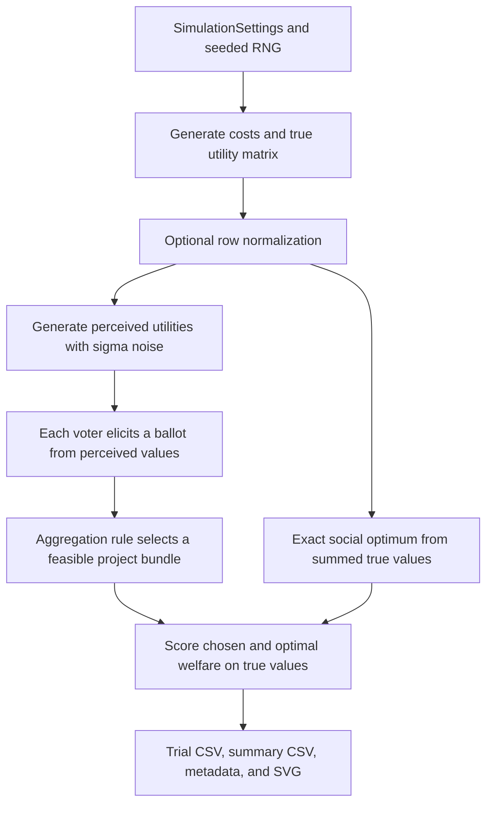

# Codebase Guide: Participatory Budgeting Distortion Project

This guide is for teammates who want to understand the current implementation before extending it. The repository implements a synthetic participatory-budgeting experiment with a knapsack ballot and greedy approval aggregation. It can generate uniform, truncated-normal, or Pareto utilities and apply multiplicative lognormal noise.

## 1. The problem this code models

There are `m` projects. Project `j` has a public integer cost, and the city has a fixed integer budget. There are `n` voters. Voter `i` has an additive value `u[i, j]` for each project `j`; the value of a bundle is the sum of its project values. A bundle is feasible when its total cost does not exceed the budget.

Voters do not submit their full utility vectors. In the currently implemented format, a voter submits one affordable bundle they would fund. The aggregation rule only sees those bundles, project costs, and the budget. To evaluate the result, the simulator retains the true utilities and compares the selected outcome to the exact welfare-maximizing feasible bundle.

The trial-level metric is:

```text
distortion = optimal feasible welfare / welfare of the selected outcome
```

In this project, this is an empirical ratio for each sampled election. It is not the paper’s formal worst-case distortion over all utility profiles consistent with a ballot profile. A distortion of 1 means the selected outcome attains the exact optimum for that generated election. The exact benchmark ensures the ratio cannot be below 1, apart from floating-point tolerance handled in the metric function.

## 2. How one election flows through the code



The true and perceived utility matrices both have shape `(voter_count, project_count)`. Their columns follow the exact order in `PBInstance.project_ids`.

### Utility and noise model

The generator supports:

- **Uniform:** draws in `[minimum, maximum]`, default `[0, 1]`.
- **Normal:** draws with configured mean and standard deviation, resampling negative values. Defaults are mean `0.5`, standard deviation `0.2`.
- **Pareto:** NumPy’s standard Pareto draw plus one, giving Pareto-I support `[1, infinity)`. Default shape is `1.5`; the code requires shape greater than one.

By default each voter’s vector is normalized to sum to one. This makes voter total value equal across voters before noise, while preserving the within-voter ranking of bundles.

For each pair of voter and project, the noise multiplier is:

```python
exp(sigma * epsilon - sigma**2 / 2)
```

where `epsilon` is a standard-normal draw. The multiplier has mean one. Noise does not replace or mutate true utilities: it creates a separate perceived profile. The ballot format receives perceived values, while the optimum and both welfare calculations use true values. At `sigma=0`, the perceived profile equals the true profile exactly. Each simulation run uses one fixed sigma. A noise sweep means several separate runs at different fixed sigma values.

## 3. File-by-file guide

### Project settings and packaging

- **`pyproject.toml`** — package metadata, Python requirement, dependencies, the `pb-distortion` command entry point, and pytest settings. Runtime dependencies are NumPy and Matplotlib; pytest is in the `dev` extra.
- **`uv.lock`** — locks package versions so teammates can recreate the environment with `uv sync --extra dev`.
- **`configs/baseline.toml`** — small single-project-count baseline settings.
- **`configs/project_count_sweep.toml`** — the main multi-count experiment. It has 200 elections at each of 10 project counts, 50 voters, seed 42, costs 1–10, budget fraction 0.33, bootstrap settings, distribution parameters, and a default sigma of zero.

### Shared data and interfaces

- **`src/pb_distortion/models.py`**
  - `PBInstance` stores ordered project IDs, integer costs, and the budget, with checks for valid dimensions and costs.
  - `UtilityProfile` stores a finite nonnegative voter-by-project NumPy matrix and its project order. The matrix is copied and made read-only.
  - `Election` bundles an instance, true utilities, and optional perceived utilities. If perceived utilities are omitted, it defaults to the true profile.
  - `Outcome` is a tuple of selected project IDs.
- **`src/pb_distortion/protocols.py`** — defines generic interfaces. An `ElicitationFormat` maps one voter’s utility vector and the public instance to a ballot. An `AggregationRule` maps a sequence of ballots and the public instance to a project outcome. This keeps the simulation independent of ballot details.

### Synthetic data

- **`src/pb_distortion/generation.py`**
  - `normalize_utility_rows` rescales each voter’s utility row to sum to one.
  - `perturb_utilities` applies the mean-corrected lognormal multiplier and checks the result is finite.
  - `generate_synthetic_election` draws project costs and utilities, creates the budget as `ceil(budget_fraction * total_project_cost)`, normalizes if requested, perturbs utilities, and returns an `Election` containing both profiles.

### Ballot format and aggregation rule

- **`src/pb_distortion/formats/knapsack.py`** — `KnapsackBallotFormat.elicit(...)` solves an exact knapsack problem using the voter’s perceived value vector. The returned ballot is a `frozenset` of project IDs.
- **`src/pb_distortion/formats/threshold_approval.py`** — `ThresholdApprovalBallotFormat.elicit(...)` approves each project where perceived utility meets or exceeds a threshold (defaulting dynamically to $1/m$, following Benadè et al. Theorem 14). The returned ballot is a `frozenset` of approved project IDs.
- **`src/pb_distortion/rules/greedy_approval.py`** — `GreedyApprovalRule` counts project appearances in knapsack ballots, orders projects by decreasing count, then project ID, and funds each project that fits. If a project does not fit the remaining budget, it skips that project and continues. Projects with zero approvals remain eligible at the bottom of the order.
- **`src/pb_distortion/rules/threshold_approval.py`** — `ThresholdApprovalRule` aggregates threshold approval ballots using greedy approval-to-cost ratio (`approvals / cost`) with skip logic (Theorem 14 of Benadè et al.). Unlike knapsack ballots, submitted ballots are not constrained by individual budget feasibility.

### Optimization and metrics

- **`src/pb_distortion/solvers.py`** — exact dynamic programming for integer-cost 0/1 knapsack. It is used for each voter’s ballot and for the social optimum. The DP runs in `O(project_count * budget)` time. It keeps a decision table for reconstruction and uses deterministic project-ID order to resolve equal-value choices. `bundle_cost` validates outcomes and ballots.
- **`src/pb_distortion/metrics.py`** — `social_welfare` sums utility across all voters for a selected project bundle. `distortion` computes optimal welfare divided by chosen welfare and guards against impossible values below one.

### Running elections, sweeps, and output

- **`src/pb_distortion/simulation.py`**
  - `SimulationSettings` contains trial count, master seed, project/voter counts, cost/budget parameters, utility distribution parameters, normalization, and noise sigma.
  - `run_simulation` derives a deterministic child seed for each election, generates the election, elicits ballots, aggregates them, solves the social optimum, scores the result on true values, and returns `TrialResult` records.
  - Output writers save trial CSV and JSON metadata, including settings, package versions, and the generated trial seeds.
- **`src/pb_distortion/sweeps.py`**
  - `run_project_count_sweep` repeats the simulation for each project count and computes the mean distortion with a percentile-bootstrap confidence interval.
  - `run_noise_sweep` repeats the project-count sweep for each fixed sigma. It uses the same master seed at every sigma, which pairs costs and true utility draws across noise levels.
  - The writer saves trial-level CSV, summary CSV, and run metadata.
- **`src/pb_distortion/plotting.py`** — plots means with asymmetric confidence intervals. SVG output is generated directly; other extensions use Matplotlib.
- **`src/pb_distortion/cli.py`** — reads TOML, handles `--distribution`, `--noise-sigma`, `--noise-sigmas`, and `--output`, wires the current knapsack format/rule, creates unique output folders, writes results, and prints summaries.

### Tests and generated files

- **`tests/test_solvers.py`** — compares the dynamic program with exhaustive enumeration on small cases.
- **`tests/test_knapsack.py`** — checks the ballot format and feasible utility-maximizing bundles.
- **`tests/test_threshold_approval.py`** — checks threshold approval ballot format cutoff logic, budget-unconstrained approval sets, aggregation ordering, tie-breaking, feasibility, and simulation integration.
- **`tests/test_greedy_approval.py`** — checks approval counts, budget feasibility, ordering, and tie-breaking.
- **`tests/test_simulation.py`** — checks generated settings, repeatability, feasible welfare, and noise semantics.
- **`tests/test_distributions.py`** — checks distributions, configuration selection, noise math, and unique output directories.
- **`tests/test_plotting.py`** — checks plotting validation and output generation.
- **`outputs/`** — generated experiment artifacts. It is excluded from Git so CSVs and plots do not enter commits accidentally.

## 4. Config values and outputs

The baseline config uses 10 projects and 200 elections. The project-count config uses:

| Setting | Value |
| --- | ---: |
| Master seed | 42 |
| Elections per project count | 200 |
| Voters | 50 |
| Project counts | 5, 10, 20, 30, 40, 50, 75, 100, 150, 200 |
| Cost range | Integer 1–10 |
| Budget fraction | 0.33 |
| Default utilities | Uniform[0, 1], normalized per voter |
| Default noise | σ = 0 |
| Bootstrap | 2,000 resamples; 95% interval |

A normal sweep uses the same values and changes only the utility distribution (unless its TOML parameters are edited). A Pareto sweep works the same way. The command-line distribution override means separate distribution config files are not needed.

Each project-count sweep writes:

- `trials.csv` — one row per election, including seed, costs/budget, optimal welfare, chosen welfare, distortion, and outcome IDs.
- `summary.csv` — one row per project count with trial count, mean distortion, and confidence interval.
- `run.json` — complete settings, seeds by project count, solver/metric descriptions, and source config.
- `distortion_by_project_count.svg` — mean curve with error bars.

A noise sweep also writes a folder for each sigma and, at the batch level, `noise_sweep_summary.csv`, `noise_sweep_run.json`, and `distortion_by_noise_sigma.svg`.

## 5. Reproducibility

The master seed is expanded into one child seed per trial. All random draws for an election use that trial’s NumPy generator. A zero-noise run skips epsilon draws, so it reproduces the previous baseline exactly. Different sigma runs use matching trial seeds; the utility draw occurs before noise, so the true utilities and costs match across sigma values. Bootstrap seeds are derived from the master seed and project count.

Do not interpret overlapping or separated bootstrap intervals as a formal theorem about worst-case distortion. They summarize the simulated elections and the chosen utility model.

## 6. Extending the repository: add another ballot format

The simulation code is already generic over ballot types. The knapsack format is currently wired directly in `cli.py`; adding a teammate’s ballot requires the new format/rule modules, focused tests, and CLI wiring. Keep the common evaluation path unchanged so every format is scored under the same elections and true-utility benchmark.

1. **Add the ballot module** under `src/pb_distortion/formats/`. Implement a class with a stable `name` and `elicit(utilities, instance)`. `utilities` is one voter’s perceived utility vector. Return a ballot type that records exactly the information the format submits. Examples are a ranking tuple or an approval set.
2. **Add the aggregation rule** under `src/pb_distortion/rules/`. Implement `aggregate(ballots, instance) -> Outcome`. Use only ballots and public instance data (project IDs, costs, budget). Do not read the true utility profile or optimize on hidden values.
3. **Add focused tests** in `tests/` for ballot semantics, aggregation ordering/ties, feasible outcomes, and edge cases. Use the existing solver tests as a model for exhaustive small-instance checks where possible.
4. **Wire the format and rule in `cli.py`** so teammates can select it from the command line. Keep `run_simulation`, `run_project_count_sweep`, and `run_noise_sweep` format-neutral; they already accept the format and rule as inputs.
5. **Run the full suite and a small seeded experiment** before a full project-count sweep. Confirm repeated seeds reproduce results, distortion is at least one, and all output metadata identifies the selected format and rule.
6. **Work on a feature branch** and submit a pull request. Avoid direct edits to shared protocols, models, solvers, or simulation wiring without coordinating with the team.

For ranking by value and ranking by value for money, the submitted ballot should preserve only the ranking that voters report. For threshold approval, the ballot should preserve only the approved set at the specified threshold. A format should not silently include more cardinal information than its definition permits.
